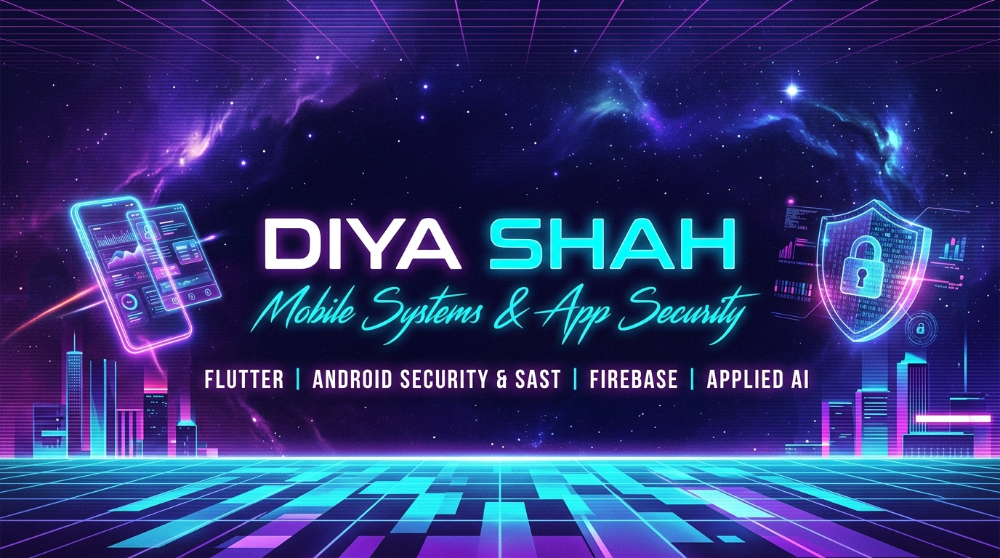
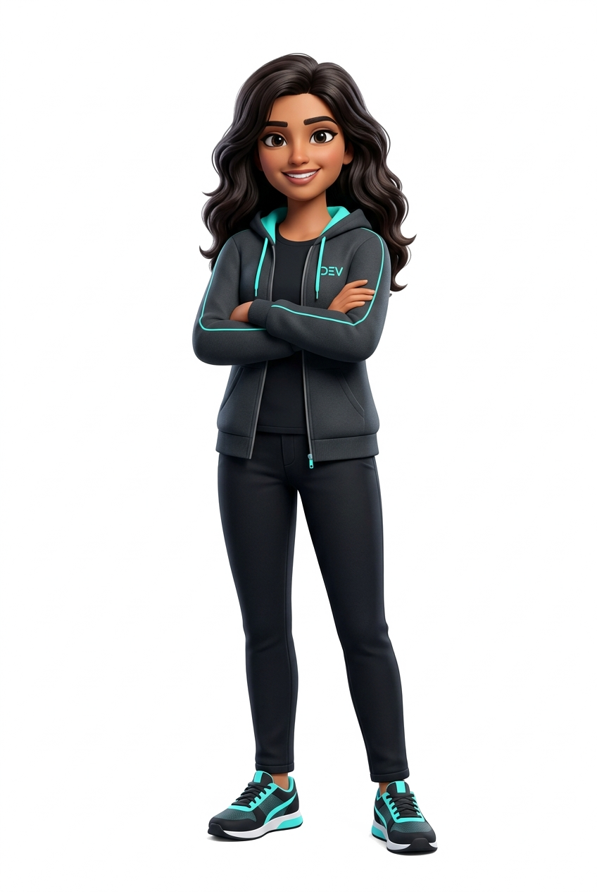

  <!-- 🎨 SYNTHWAVE DEVELOPER BANNER -->
  

 

<table border="0" cellpadding="0" cellspacing="0" width="100%">
  <tr>
    <td width="68%" valign="middle">
      <h1>Hi, I'm Diya Shah 👋</h1>
      <h3>Full Stack Developer · Flutter &amp; Python · Mobile App Security · AI Integration</h3>
      

        
      

      

        B.Tech <b>Information Technology</b> student at <b>CHARUSAT (CSPIT)</b>, Gujarat, India. 
        I turn real-world problems into working products, end to end: <b>Flutter mobile apps</b>, <b>Python/Flask backends</b>, <b>Firebase</b> cloud services and <b>machine learning</b> features, designed with <b>system design</b> thinking.
      

    </td>
    <td width="32%" align="center" valign="middle">
      
    </td>
  </tr>
</table>

  
  &nbsp;
  
  &nbsp;
  
  &nbsp;
  
  &nbsp;
  

---

<table border="0" cellpadding="0" cellspacing="0" width="100%">
  <tr>
    <td width="55%" valign="top">
      <h3>About Me. 🤩</h3>
      <ul>
        <li>🎓 <b>B.Tech Information Technology</b> at CHARUSAT (CSPIT), after a Diploma with <b>9.46 CGPA</b> and <b>All Gujarat Rank 58 in DDCET</b> among 20,000+ students.</li>
        <li>📱 <b>Flutter &amp; Dart</b> developer with a Flutter internship at <b>Toshal Infotech</b>.</li>
        <li>🧱 <b>Full stack</b>: Flutter front ends, <b>Python/Flask</b> and <b>REST API</b> backends, <b>Firebase</b> (Auth, Firestore, Storage).</li>
        <li>🛡️ Building <b>Mobile App Security (SAST)</b> tools: OWASP Mobile Top 10, pure-Python APK audits.</li>
        <li>🤖 Building <b>AI-infused applications</b>: NLP resume matchers, conversational assistants.</li>
        <li>💬 Ask me about: <b>Flutter, Python, Firebase, system design, mobile app security, AI integration</b>.</li>
        <li>🔎 <b>Open to internships and entry-level roles</b> in Gujarat, India, or remote.</li>
      </ul>
    </td>
    <td width="45%" valign="top">
      <h3>Achievements. 🏆</h3>
      <ul>
        <li>🏆 <b>Winner</b>, IBM Bob Hackathon 2026</li>
        <li>🥉 <b>3rd place</b>, CHARUSAT × IBM AI Innovation Hackathon</li>
        <li>🔐 <b>4th position</b>, CyberKavach CTF (OSINT and ethical hacking)</li>
        <li>🎖️ <b>All Gujarat Rank 58</b>, DDCET (20,000+ students)</li>
        <li>📚 <b>9.46 CGPA</b>, Diploma in Computer Engineering</li>
      </ul>
      <h3>Experience. 💼</h3>
      <ul>
        <li><b>Flutter Developer Intern</b>, Toshal Infotech</li>
        <li><b>B.Tech IT</b>, CHARUSAT (CSPIT), Gujarat, India</li>
      </ul>
    </td>
  </tr>
</table>

---

### 🚀 Key Projects. 🌟

<table width="100%" border="0" cellpadding="0" cellspacing="12">
  <tr>
    <td width="50%" valign="top">
      <h4>🛡️ <a href="https://github.com/diya2405/apk_vulnerability_analysis">Mobile App Security Analyzer</a></h4>
      

        
        
        
        
      

      
<b>Static Application Security Testing (SAST) &amp; Binary SBOM for Android APKs</b>

      <ul>
        <li>⚡ <b>Pure Python, zero JVM</b>: scans full APK binaries in <b>3 to 6 seconds</b> without heavy Java decompilers.</li>
        <li>🔍 <b>Byte-level parser</b>: reads compiled <code>AXML</code> manifests, Dalvik <code>dex</code> bytecode and native <code>.so</code> ELF libraries directly.</li>
        <li>📋 <b>Standards-mapped</b>: OWASP Mobile Top 10 (2024), OWASP MASVS v2.0, CycloneDX 1.5 JSON SBOM output.</li>
      </ul>
      

        
      

    </td>
    <td width="50%" valign="top">
      <h4>💼 <a href="https://github.com/diya2405/JobFlow">JobFlow: AI Recruitment Platform</a></h4>
      

        
        
        
        
      

      
<b>AI-powered mobile recruitment platform with a unified three-portal workflow</b>

      <ul>
        <li>📱 <b>Tri-portal architecture</b>: separate reactive mobile interfaces for <b>job seekers</b>, <b>companies/HR</b> and <b>admins</b>.</li>
        <li>🤖 <b>AI resume matching</b>: resume parsing, skill extraction and candidate-to-job match scoring.</li>
        <li>⚡ <b>Real-time sync</b>: instant application status updates and notifications via <b>Cloud Firestore</b>.</li>
      </ul>
      

        
      

    </td>
  </tr>
  <tr>
    <td width="50%" valign="top">
      <h4>🤖 <a href="https://github.com/diya2405/Ai_Assistant">Ai_Assistant</a></h4>
      

        
        
        
      

      
<b>Multi-model AI assistant mobile app built with Flutter</b>

    </td>
    <td width="50%" valign="top">
      <h4>🏆 IBM Bob Hackathon 2026: Winning Project</h4>
      
<b>Winner, IBM Bob Hackathon 2026.</b>

      
<i>Add the project name, a one-line summary and the repo link here.</i>

    </td>
  </tr>
</table>

  <a href="https://github.com/diya2405?tab=repositories">
    <b>🔍 Explore all 37 public repositories on my GitHub ➜</b>
  </a>

---

### Tech Stack. 🛠️

<i>Technologies and frameworks I actively use and build with:</i>

#### 📱 Mobile Development &amp; UI

  
  
  
  

#### 🧱 Backend, Cloud &amp; APIs

  
  
  
  
  
  

#### 🛡️ App Security &amp; AI

  
  
  
  
  

#### ⚙️ Developer Tools

  
  
  
  
  

---

### Stats. 📊

  <table border="0">
    <tr>
      <td valign="top">
        
      </td>
      <td valign="top">
        
      </td>
    </tr>
    <tr>
      <td colspan="2" align="center">
        
      </td>
    </tr>
  </table>

 

  
⭐ <b>If my projects help you, a star on the repo helps others find them.</b> ⭐

  
Open to <b>Flutter</b>, <b>Python/ML</b> and <b>full stack developer</b> internships and entry-level roles · Gujarat, India · Remote

  

